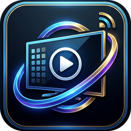

# StreamGuide

**Le lecteur IPTV pour Android, Android TV et Fire TV.**
TV en direct, films, séries, guide des programmes et enregistrement, dans une seule application.

**Version 0.1.0** · Android · Android TV · Fire TV

---

## 📥 Télécharger

### Android TV, Fire TV, box Android — avec Downloader

Ouvrez l'application **Downloader** sur votre téléviseur ou votre box et saisissez ce code :

# `5982574`

1. Installez **Downloader** (by AFTVnews) depuis la boutique d'applications de votre appareil.
2. Ouvrez Downloader et tapez le code **`5982574`** dans le champ de saisie, puis validez.
3. Une fois le téléchargement terminé, choisissez **Installer**.
4. Si l'appareil le demande, autorisez Downloader à installer des applications inconnues
   (Paramètres → Applications → Sources inconnues).

### Téléphone et tablette Android

Téléchargez directement le fichier
[`StreamGuide-0.1.0-android-arm64.apk`](https://github.com/aymanerei/stream-guide/releases/download/v0.1.0/StreamGuide-0.1.0-android-arm64.apk),
ouvrez-le et acceptez l'installation.

Toutes les versions sont sur la page [Releases](https://github.com/aymanerei/stream-guide/releases).

### Mac

La version Mac (Apple Silicon) n'est pas encore publiée.

---

## ✨ Fonctions

| | |
|---|---|
| 📺 **TV en direct** | Listes Xtream Codes et M3U, guide des programmes, logos des chaînes, qualité vidéo réelle affichée. |
| 🎬 **Films et séries** | Catalogue complet, reprise de lecture là où vous vous êtes arrêté, « Ma liste ». |
| 🎭 **Fiches détaillées** | Synopsis, acteurs avec photos, titres similaires, bande-annonce. |
| ⚽ **Sport** | Programmes sportifs en direct et à venir, tirés du guide. |
| ⏺️ **Enregistrement** | Enregistrement des chaînes en direct et relecture. |
| 👨‍👩‍👧 **Profils et code parental** | Profil enfant, catégories masquées, réglages verrouillés par code. |
| 🔎 **Recherche** | Chaînes, films et séries dans une seule recherche. |

---

## 🚀 Premiers pas

1. Lancez StreamGuide et ouvrez **Listes**.
2. Ajoutez votre liste : identifiants **Xtream Codes** ou adresse d'un fichier **M3U**.
3. Patientez pendant la première synchronisation (une à deux minutes pour un gros catalogue).

### Option facultative

Une **clé TMDB** (gratuite, [themoviedb.org](https://www.themoviedb.org/)) ajoute les tendances de la
semaine sur l'accueil, les recommandations par titre et des synopsis en français.
Elle se saisit dans **Paramètres**.

---

## ⚠️ Limites connues

- Le replay dépend de votre fournisseur.
- Pas de multi-écran réel, pas de choix de pistes audio ni de sous-titres.
- Pas de version Windows, Linux ni iOS pour l'instant.

---

## 🙏 Données ouvertes

- [TMDB](https://www.themoviedb.org/) — *This product uses the TMDB API but is not endorsed or certified by TMDB.*
- [TVmaze](https://www.tvmaze.com/) — distribution des séries (CC BY-SA).
- [Wikidata](https://www.wikidata.org/) et Wikimedia Commons — distribution et films liés.
- [iptv-org](https://github.com/iptv-org) — logos de chaînes manquants.

---

**StreamGuide ne fournit aucun contenu.**
L'application lit uniquement les listes de votre propre fournisseur.

